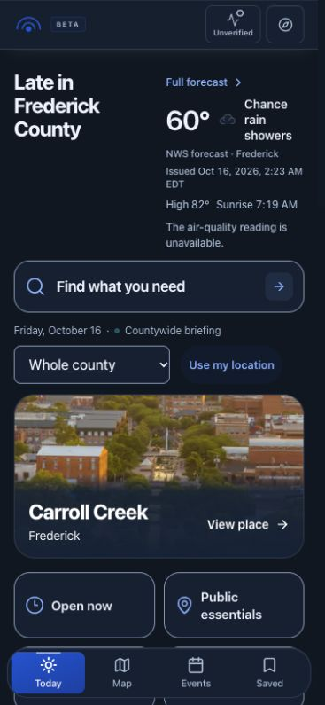
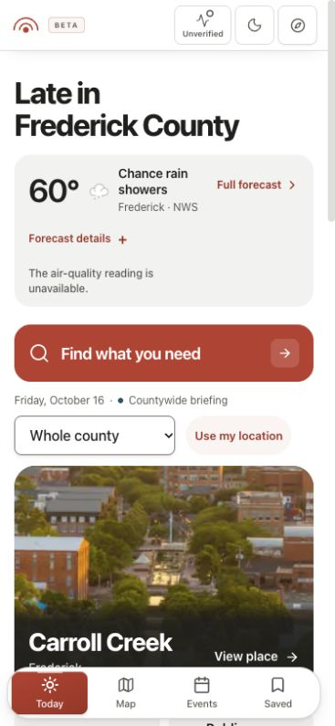

# White, charcoal and coral: actual Today comparison

Both captures use a 375 × 812 phone viewport. The before capture is production revision `690479b5c5d419b517461dc36efb7920031fa003`; the after capture comes from the production build of `codex/white-charcoal-coral-20261016`.

| Before | After |
| --- | --- |
|  |  |

The after view starts light even when the device prefers dark. A deliberate appearance choice can be saved with the header control. Weather leads discovery, routine forecast evidence remains available in its native disclosure, Find uses the approved deep coral, and the exact Carroll Creek photograph is larger.

These are real app captures, not a parallel design demo. Source availability can differ between the public baseline and the local build. The screenshots document layout and appearance; source timestamps, safety states and provider facts must be read from the running app. This change does not regenerate the catalog or change provider configuration.
